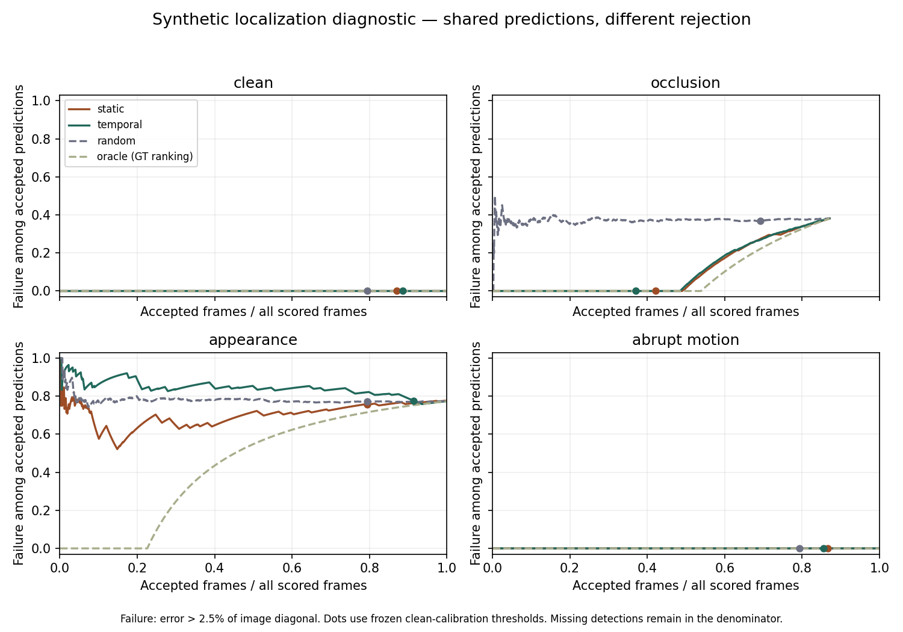

# Embodied Vision Reliability

Latest result: the [fixed current-frame crop-detail baseline](results/0032-development/complete-01/README.md) loses **3.7811 J&F points** on DEV (92.1772%→88.3962%), with both parents worse. All241 outputs were sealed before scoring;239 additional encodings/decodings cost145.7963seconds. The unchanged rule closes this exact known-method adaptation. No substantial improvement or new method is established.

Previous result: the [fixed initial-boundary-pair information screen](results/0031-development/complete-01/README.md) fails its prospective continuation rule. Across 96 TRAIN events, paired crossing correctness is 65.3646% versus native 82.6497%; its joint loss is worse than native and the deranged-pair control. No paired refinement head is admitted. A five-choice global threshold selected on TRAIN chooses the native threshold 0, so DEV J&F remains 92.1772%. Neither result is an improvement or manuscript contribution.

The closed learned-memory comparison: the complete seven-arm rho=0.15 / seed=0 comparison closes this exact channel-affine memory-content family under its predeclared rule. All-active direct training gains **+0.2233 J&F points** overall but changes the two DEV parents by **+0.4765/−0.0299**; both had to improve. Multistep distillation loses **0.4934** points, and the current-GT-memory control gains only **+0.2139**. [All seven arms and actual costs](results/0030-development/active-write-01/README.md) · [Closure and limits](results/0030-development/channel-affine-closure.md). These exposed single-object development results do not meet the research goal.

**Goal: a substantial, reproducible computer-vision improvement relevant to embodied systems or driving before a CVPR-targeted manuscript. No method currently meets that goal.**

The [0030 development campaign](protocols/0030-development-campaign.md) tests a causal memory-content head learned from a multistep future-loss optimizer against the same head trained directly. All 48 teacher anchors, three 288-update regressor fits, both original direct controls and the original six complete DEV rollouts are finished. Native replay reproduces the baseline exactly: J 94.7652%, F 89.5893%, J&F 92.1772%. Teacher TRAIN surrogate loss falls about 5.67%, and the final multistep head reduces target-fit error to 0.5097 of the zero predictor's error. The [saved-teacher replay](results/0030-development/teacher-task-alignment-01/README.md) gains only +0.3276 J&F pp on fixed TRAIN contexts. The [full GT-mask/presence memory replay](results/0030-development/full-gt-write-01/README.md) gains +0.2611 pp. Neither is causal deployment or an upper bound. [Related future-supervision methods](docs/0030-future-memory-write-prior.md) and [local storage-mask precedents](docs/0030-local-storage-prior.md) limit broad novelty claims; no new-method or driving result is established.

The separately [admitted all-active-write fit](experiments/0030-memory-content/active-write-diagnostic/ADMISSION.md), final-checkpoint rollout and evaluation completed cleanly. Its 250 updates used 1,152.3877 outer seconds, within the 1,168.5096-second complete-fit budget. J&F 92.4005 exceeds GT-memory by just 0.0094 points, but the upside-down loss fails the other fixed condition: **no seed-1 continuation or further KD/rho rescue of this exact family**. Fixed baseline histories make this training distinct from recurrent BPTT.

A [saved-native-output analysis](results/0030-development/output-error-analysis-01/README.md) retains all 150 interior DEV frames: 77.9971%/97.8042% of error pixels lie within the official tolerance radius of the GT boundary, with no complete target misses or disjoint nonempty masks. This descriptive evaluator information does not establish a causal repair signal. A distinct TRAIN paired-boundary information screen is being prepared; no new head or efficacy result is established. [PR66 publication verification](docs/0030-pr66-publication-verification.md).

The current VOS manuscript gate is **+3 absolute official J&F points on each of two independent held-out sources**, positive paired recording-level 95% intervals, neither J nor F down more than 0.5 point, strong controls at a common complete-pipeline budget, ablations and independent replication. A successful software check or training-loss reduction does not meet it. [Development and final-evidence policy](docs/0030-development-policy.md). Historical camera-motion gates and failed results remain unchanged.

## Current evidence · October 20, 2026

| Study | Verified result | Decision |
|---|---|---|
| [0032 fixed crop detail](results/0032-development/complete-01/README.md) | DEV J&F−3.7811pp; both parents decline; all241 predictions and150 interior metrics complete. | Exact recipe closed. Known-method adaptation, no paper. |
| [0031 paired boundary and calibration](results/0031-development/complete-01/README.md) | Paired crossing correctness65.36% versus native82.65%; global calibration selects native threshold0. | Pair lookup closed; no gain. |
| [0030 learned memory content, complete seven-arm result](results/0030-development/active-write-01/README.md) | J&F 92.1772 native; 91.6838 multistep; 91.9915 one-step; 92.3911 GT-memory; 91.2875 cost-matched direct; 91.4281 update-matched direct; 92.4005 all-active direct. | Exact family closed by fixed rule: all-active improves only one of two DEV parents. No paper or held-out success. |
| [0029 fixed memory deletion](results/0029-development/native-attempt-02/README.md) | Six videos/386 frames/48 queries; signed loses 0.047759 pp to strongest control; admissible oracle headroom 0.076821 pp; independent audit 12,463 checks/0 errors. | Closed. Custom query J, not official J&F; no manuscript. |
| [0028 normal information](results/0028-development/README.md) | ANG AUC@5 2.6954% versus E 51.0001% (−48.3047 pp), all 3 scene margins negative; independent audit 2,451 checks pass. | Closed. No held-out expansion or manuscript. |
| [0027 affine tangent](results/0027-development/README.md) | All138 rows;57/128 useful noisy T poses versus57/128V. Two of four fixed clauses fail;41,707 audit checks pass. | Closed. No real-data expansion or manuscript. |
| [0026 calibration moments](results/0026-development/README.md) | AUC@5 73.5881% versus strongest control74.1397% (−0.5516pp); three of four conditions fail. Independent saved-output audit agrees. | Closed. No held-out expansion or manuscript. |
| [0025c initializer noise](results/0025c-development/README.md) | 13,332 attempts; every required D4 yield fails; D8 beats A8 in 0/96 primary records. Independent gate agrees; original numerical audit remains failed on one invalid diagnostic. | Closed. No robust stage, real-data expansion or manuscript. |
| [0025b physical depth qualification](results/0025b-development/README.md) | 80 forwards, 64/64 primary pairs; scene median AbsRel 2.936% / 2.293%; fixed tolerances pass and independent arithmetic audit agrees. | Assumption qualified only. GS oracle remains better; no pose improvement or manuscript. |
| [0025 rolling-shutter geometry](results/0025-identifiability/README.md) | Fixed numerical rank checks, exact nonzero four-point determinant under given rotations, and independently checked critical configurations. | Mathematical feasibility only; no accuracy or novelty result. Subsequent physical assumption check: 0025b above. |
| [0024 virtual-rotation offset](results/0024-development/README.md) | 16/27 usable offsets; cross-axis residual increased 1.986%; all four conditions failed. | Closed. No downstream pose experiment. |
| [0023 directional instability](results/0023-development/completed-study/README.md) | AUC@5 56.4971% versus strongest geometry control 61.9844% (−5.4874 pp). | Closed. All efficacy conditions failed. |
| [0020 spatial depth transfer](results/0020-spatial-depth-transfer/README.md) | Candidate AUC@5 71.1071% versus strong affine control 74.0717% (−2.9646 pp). | Closed. No same-label rescue tuning. |

[Closed noise-test result](results/0025c-development/README.md) · [Current state](CURRENT_STATE.md) · [Next actions](NEXT_ACTIONS.md)

## Historical evidence through 0015


| Study | Verified result | Decision |
|---|---|---|
| [0015 sparse image correction](results/0015-photometric/README.md) | Full AUC@5 +0.009558333pp; same-index subset −3.091052179pp;9/16 full errors improve. | Expansion gate fails. Stop this sparse configuration. |
| [0014 known pixel-noise control](results/0014-pixel-noise-arithmetic-repair/README.md) | AUC@5 81.169622%→81.176133%, only+0.006510542pp;9 pair improvements/7 harms; strict diagnostic gate15/16. | No material gain. Stop noise-only correction. |
| [0013 official pose baseline](results/0013-baseline-calibration-compatibility/README.md) |16/16 selected development pairs; AUC@5/10/20=81.17/90.58/95.29%; translation dominates15/16. | Baseline measurement, not a new method. |
| [0012d compiled lazy scoring](results/0012d-lazy-grid/development/README.md) |17.142ms versus13.065ms ordinary partial scoring; exact winners but31.21% slower. | Stop this scorer family. |
| [0011 oblique coordinate coupling](results/0011-oblique/README.md) |62.96% versus64.19% quality; worse endpoint error. | Stop this candidate. |
| [0010 query-deleted adaptation](results/0010-headroom/README.md) |61/128 versus65/128 correct. | Stop this candidate. |

0013/0014 are published on main with independent saved-output reviews and exact
PR/main CI checks: [publication verification](docs/0013-0014-publication-verification.md).
These16 pairs share images and come from one reused development scene; they are
not independent held-out evidence. Initial execution failures and separately
frozen technical repairs remain public. No favorable sample selection, weaker
comparison or post-hoc gate change is used to turn these results into success.

The23 paired images are acquired and the fixed photometric diagnostic is complete.
Lower patch loss did not produce meaningful pose improvement. A distinct follow-up
needs evidence of recoverable information; generic joint refinement or correction
propagation is already established prior work.
[Current state](CURRENT_STATE.md) · [Next actions](NEXT_ACTIONS.md) ·
[Shared-pixel identifiability](docs/literature/0015-shared-pixel-identifiability.md).

This AI-assisted research program runs October2026–October2027. Published math
and methods are attributed; generic covariance weighting, affine refinement and
standard GLS identities are not claimed as new. The owner requires a substantive
method and measured improvement before writing. [Contributions](docs/CONTRIBUTIONS.md).

## Research state and historical localization archive

| Artifact | What it answers |
|---|---|
| [Current state](CURRENT_STATE.md) | What has actually been completed? |
| [Conversion evidence and executable geometry input](docs/0003-source-history-and-geometry-plan-2026-10-17.md) | What does the one saved-R compatibility result establish, and what complete prospective input awaits review? |
| [Cached conversion history and next candidate](docs/0003-source-history-stageA-2026-10-17.md) | How strong is the float16 explanation, what source links are missing, and what descriptive check is proposed? |
| [Frame 0 rotation failure: recorded diagnostic](docs/0003-rotation-diagnostic-stageB-2026-10-17.md) | Which exact stored camera defects trigger the unchanged gate, and what can precision evidence establish? |
| [Frozen Fortran audit: reader complete, geometry stopped](docs/0003-fortran-stageB-2026-10-17.md) | What did the one cache-only run access, and why did its first camera check stop? |
| [Motion versus drift: frozen design and data audit](docs/0003-review-and-readiness.md) | What can the next study distinguish, what is the improvement target, and why is its independent cohort still blocked? |
| [PointOdyssey cached sample audit](docs/0003-cached-resource-audit-2026-10-17.md) | What did the cloud actually download and inspect, and where did the bounded reader stop? |
| [Post-hoc motion-residual diagnosis](docs/analysis/0002-motion-residual-posthoc.md) | Which exact decision exchanges explain the negative pilot result? |
| [Frozen v2 evaluation](docs/0002-frozen-evaluation-v2-2026-10-17.md) | Did the extra motion residual meet the practical benefit criterion? No; all results and independent checks are retained. |
| [All frozen predictions: 30/30](docs/0002-prediction-collection-complete-2026-10-17.md) | Where are 10 calibration and 20 evaluation raw prediction sets, before scoring? |
| [Calibration collection: 10/10](docs/0002-calibration-complete-2026-10-17.md) | Where are all ten raw prediction sets, and what remains before evaluation? |
| [Calibration group: g-020](docs/0002-g020-calibration-inference-2026-10-17.md) | What ran next, with raw predictions and explicit child/parent exit evidence? |
| [Calibration group: g-039](docs/0002-g039-calibration-inference-2026-10-17.md) | What ran next, with complete predictions and supervised, cycle-safe verification records? |
| [Calibration group: g-040](docs/0002-g040-calibration-inference-2026-10-17.md) | What ran next, with raw predictions and parent-observed inference and verification exits? |
| [Calibration group: g-022](docs/0002-g022-calibration-inference-2026-10-17.md) | What ran next, with complete raw outputs, separate parent/child exits and independent provenance checks? |
| [Calibration group: g-013](docs/0002-g013-calibration-inference-2026-10-17.md) | What ran next, with independently observed wrapper exit and complete raw/provenance checks? |
| [First calibration group: g-033](docs/0002-g033-calibration-inference-2026-10-17.md) | What did the frozen model produce, and how was a dependency failure preserved and resolved? |
| [64-frame result and exploratory freeze](docs/0002-64frame-and-freeze.md) | What ran on cloud CPU, how are videos grouped, and what is frozen for later execution? |
| [Real-model CPU feasibility](docs/0002-cpu-feasibility.md) | Can the frozen Online BootsTAPIR model run within the cloud CPU budget? |
| [Research charter](docs/RESEARCH_CHARTER.md) | What is the question, and what would count as progress? |
| [Reading list](docs/LITERATURE.md) | Which primary papers inform the design, and how closely have they been read? |
| [Next actions](NEXT_ACTIONS.md) | What experiment or verification comes next? |
| [Cloud execution](docs/CLOUD_EXECUTION.md) | How is daily work validated and published, and is the hosted schedule active? |

## First result · October 16, 2026

A stable wrong track can still look reliable. In a deliberately constructed appearance-change case, both image-only and temporal scores continued accepting many wrong positions. Adding a motion residual did not resolve the identity switch. Under occlusion, it reduced accepted coverage without reducing the already-zero observed error among accepted predictions.

The diagnostic uses 40 held-out base sequences in four conditions, with a fixed color-based estimator. This is a reproducible failure analysis, not a learned-model or robot benchmark. [Read the result and limitations](notes/2026-10-16.md) · [Raw measurements](results/0001-pilot/summary.json) · [Protocol](protocols/0001-synthetic-localization.md).

The [follow-up failure analysis](docs/analysis/0001-failure-mechanism.md) explains the mechanism: two wrong positions fill the temporal history, making the next wrong position look consistent. After the transition, the temporal gate accepts all 880 wrong predictions in the saved test set. It also rejects correct predictions at a sudden turn and just after occlusion clears. The analysis preserves the original scores and thresholds and can be reproduced directly from the saved CSV.



## Reproduce the first diagnostic

On macOS or Linux with Python 3.9 or later:

```bash
git clone https://github.com/Simonn777/embodied-vision-reliability.git
cd embodied-vision-reliability
python3 -m venv .venv
source .venv/bin/activate
python -m pip install -e '.[dev]'
python -m pytest -q
python scripts/run_experiment.py --output scratch/reproduce-0001 --protocol protocols/0001-synthetic-localization.md
```

The runner requires a committed, unchanged protocol, writes into a new output directory, and stops after 30 minutes. It records raw predictions, configuration, source hashes, environment, and measurements. Add `--smoke` and choose another output directory for a smaller run using separate sequence IDs. A repeated run checks reproducibility; it is not an independent research finding.

The [frozen protocol](protocols/0001-synthetic-localization.md) specifies the generator, predictor, scores, partitions, and metrics. No model weights or dataset downloads are needed for this diagnostic.

## Scope

**Historical 0003 milestone (now deferred because the original cache/markers are missing):** experiment 0003 had a frozen design and a verified PointOdyssey sample archive. The complete archive inventory contains 14,415 members and two named annotation parents. Their independence is unverified; the sample is reserved for development. The bounded annotation reader stopped on unsupported Fortran-order arrays before interpreting numeric ground truth, so no geometry or model improvement result is claimed. The [review and readiness guide](docs/0003-review-and-readiness.md) connects the protocol, its prospective addenda, actual evidence and remaining gates.

The following paragraphs retain the earlier experiment 0002 milestones; its complete prediction collection and negative frozen evaluation are reported at the end.

Online BootsTAPIR has completed the 64-frame development check and the first frozen calibration group, g-033. The latter produced 128 rows for two points on cloud CPU, with a 49.29-second inference subprocess and a 2.435 GiB peak RSS. A NumPy version mismatch stopped the first attempt before inference; its failure record is preserved alongside the exact-version environment reconstruction and completed run. [Read the measurements and raw outputs](docs/0002-g033-calibration-inference-2026-10-17.md).

The next group, g-013, has also completed once: 128 rows, 49.411 seconds for the inference subprocess, and 2.435 GiB peak RSS. A separate parent process recorded successful completion of the full wrapper. The run reused cached dependencies and data, with no downloads or frozen-input changes. [g-013 evidence](docs/0002-g013-calibration-inference-2026-10-17.md).

Group g-022 has now completed once: 128 rows, 57.829 seconds for the inference subprocess, and 2.435 GiB peak RSS. Both the inference child exit and the parent-observed wrapper exit were 0. No download, model replay or frozen-input change occurred. [g-022 evidence](docs/0002-g022-calibration-inference-2026-10-17.md).

Group g-040 completed once: 128 rows, 47.834 seconds for the inference child and 2,553,160 KiB peak RSS. Separate parent records cover wrapper and post-run verification exits. No downloads or frozen changes. [g-040 evidence](docs/0002-g040-calibration-inference-2026-10-17.md).

Group g-039 completed once: 128 rows, 48.157 seconds for the inference child and 2,553,996 KiB peak RSS. Parent records retain inference and post-run exits plus source/log bindings; no downloads or frozen changes. [g-039 evidence](docs/0002-g039-calibration-inference-2026-10-17.md).

Group g-020 completed once: 128 rows, 54.620 seconds for the inference child and 2,553,192 KiB peak RSS. Raw results and distinct child/wrapper/post-run records are retained; no downloads or frozen changes. [g-020 evidence](docs/0002-g020-calibration-inference-2026-10-17.md).

The final four calibration groups completed serially without replaying the previous six. Their receipts and the [complete calibration index](docs/0002-calibration-complete-2026-10-17.md) retain measurements and raw hashes. All 20 evaluation-group predictions have now been collected serially; see the [complete collection report](docs/0002-prediction-collection-complete-2026-10-17.md). The first frozen evaluation and calibration fit are now complete; the added residual did not meet the practical benefit criterion.

The allocation remains 1 development, 10 calibration, 20 evaluation and 19 reserve videos. Calibration prediction collection is **10/10 complete**; evaluation prediction collection is **20/20 complete**. The frozen comparison has now run once: augmented minus native matched risk is +0.169683 pp (95% CI -0.157781 to +0.712631 pp); practical signal false. See the [full result](docs/0002-frozen-evaluation-v2-2026-10-17.md). The [development report and frozen v2 protocol](docs/0002-64frame-and-freeze.md) describe the experiment and grouping. Shared objects and camera, unknown scene dependencies and unresolved checkpoint exposure limit interpretation.

The first experiment is a synthetic 2D localization diagnostic. Its purpose is to validate the evaluation machinery and expose failure cases. It does not measure robot control, prove generalization to real video, or establish a new method. Its later public-video evaluation and rejected tracking intervention are retained above; the active denoising question has a separate prospective protocol.

The initial implementation runs on CPU. Apple MPS is available on the development machine; CUDA is unavailable, and no NVIDIA GPU measurements are reported. No paid compute is configured.

## Research practice

Historical geometry execution check: [October 18 cache blocker](docs/0003-cache-blocker-2026-10-18.md).
The 45-input frozen-source gate passes, but required data and historical markers
are unavailable in the current filesystem. The descriptive operation was not run;
no new geometry or model result is claimed.

- Keep full sequences in separate development, calibration, and evaluation partitions.
- Fix the protocol before inspecting the final comparison and preserve all conditions.
- Report error together with the fraction of predictions accepted; estimate uncertainty across sequences.
- Link claims to executable runs and distinguish hypotheses from measurements.

Original code and generated diagnostic assets: [MIT](LICENSE). Third-party papers, datasets, and model weights retain their own licenses.
