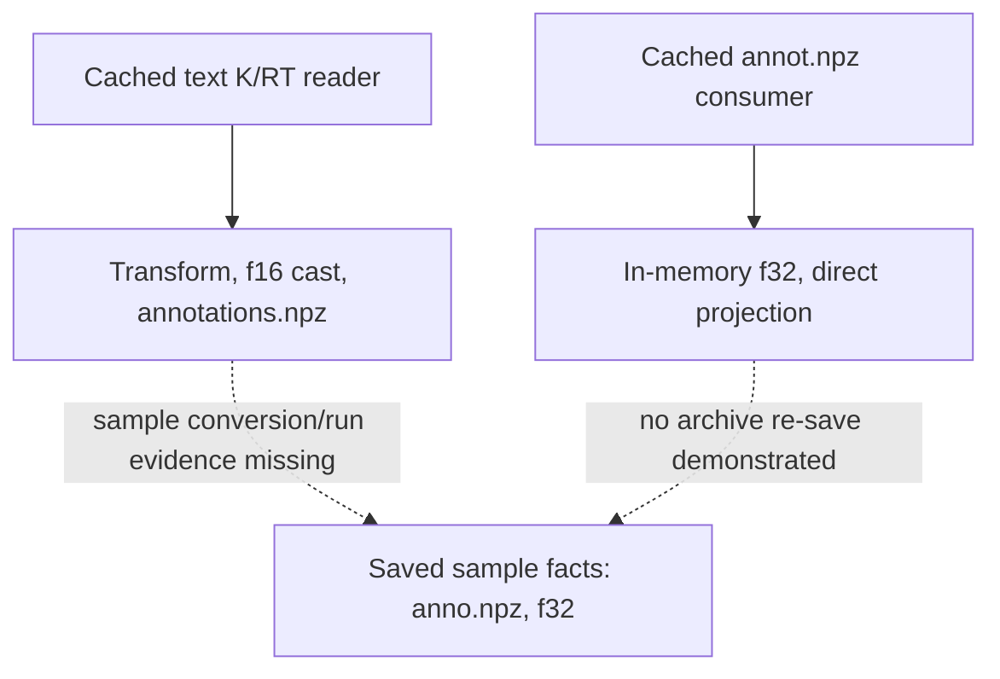

# PointOdyssey conversion history: cached-source audit and next candidate

**Stage A only, unfrozen and not a new geometry result.** AI-assisted source audit
completed October 17, 2026, America/New_York (actual UTC log: October 18,
01:58:59–01:59:00). Base main: `2826fac713fd998e4edf1666017c4944f98002d3`.
No data archive, NPZ, metadata member or RGB was opened. No camera/GT decoding,
projection, model, old-test analysis, precision experiment or new threshold fitting.

## What was actually available

The audit statically read **five complete cached bodies**, 29,614 bytes, plus a
9,811-byte cached Git-tree listing: **39,425 bytes total**. Each body's SHA256 and
Git blob SHA match the existing pinned tree at
`a053342a72fed32af4134b4ca0c44a78a3ac0fdb`. Full hashes, complete inspected line
ranges, fixed lexical-search hits and coverage gaps are in
[audit.json](../results/0003-source-history-stageA-20261017/audit/audit.json).
The text was never executed or republished. Lexical hits indicate where text
occurs, not execution or causal evidence.

The cached tree lists 41 entries / 38 blobs; only these five bodies are cached.
The other **33 bodies were not examined**, including camera renderer code and other
tracking/export variants. Tree filenames do not establish those bodies' contents.
A no-lazy-fetch `git cat-file --batch-check` found **0/39 upstream objects** (the
pinned revision plus 38 blobs) in the existing repository object store. There is no
available upstream commit history to inspect; no additional fetch/download was made.
This cannot establish that a converter is absent from upstream or another version.

| Cached path at the pinned revision | SHA256 prefix | Specific evidence (1-based lines) |
|---|---|---|
| [utils/gen_tracking_indoor.py](https://github.com/y-zheng18/point_odyssey/blob/a053342a72fed32af4134b4ca0c44a78a3ac0fdb/utils/gen_tracking_indoor.py) | 413f680d2dd8 | 123–125 define export transforms; 135–137 and 155–157 load text K/RT and transform RT; 198–212 cast arrays/cameras to f16; 215–220 save annotations.npz. |
| [utils/reprojection.py](https://github.com/y-zheng18/point_odyssey/blob/a053342a72fed32af4134b4ca0c44a78a3ac0fdb/utils/reprojection.py) | c226ff24be50 | 26–33 directly apply RT, divide camera z, then K; 65 reads annot.npz; 66–68 cast loaded trajectories/cameras to f32 in memory; 81–85 show an inactive older-version transform. |
| [export_annotation.py](https://github.com/y-zheng18/point_odyssey/blob/a053342a72fed32af4134b4ca0c44a78a3ac0fdb/export_annotation.py) | 1464c84e8c80 | 41–54 orchestrate renderer invocation; 55–63 invoke EXR/mesh exports; 64–67 invoke indoor tracking. Not a sample conversion/run log. |
| [utils/export_scene.py](https://github.com/y-zheng18/point_odyssey/blob/a053342a72fed32af4134b4ca0c44a78a3ac0fdb/utils/export_scene.py) | 1dd0b26f1f95 | 25 opens a Blender scene; 35–37 edit scene-info assets/characters; 50–72 export meshes; 75–76 save scene-info. No camera-archive conversion demonstrated. |
| [README.md](https://github.com/y-zheng18/point_odyssey/blob/a053342a72fed32af4134b4ca0c44a78a3ac0fdb/README.md) | f8bb2457a46f | 9–12 describe v1.2 mask/depth fixes and v1.1 camera simplification; 108–112/123–138 discuss camera/multiview generation; 146 dataset terms; 152 points to reprojection conventions. |

Only this single README revision is cached: its release descriptions are not a
version diff or proof of which script generated this sample. A rendered scene's
camera scale, actual text K/RT inputs, their creation code and the specific sample's
export/conversion command, configuration, seed and software history remain unknown.
The reprojection example's depth conversion/visualization comments do not establish
world units or physical FPS for the selected sample.

## Conversion-chain evidence strength

**Established static path:** the indoor generator computes projection before its
saved arrays are cast to half precision. It then writes `annotations.npz` with
`trajs_2d`, `trajs_3d`, `visibilities`, `intrinsics`, `extrinsics`. The camera keys
already match the selected sample: K/RT are local variable names, so an additional
K/RT-key rename is not shown or needed to explain these two key names.

**Established consumer example:** `reprojection.py` reads `annot.npz` and casts
loaded camera arrays to f32 **in memory**. It does not save a widened annotation
archive. Thus this example does not prove the selected archive was stored f32 by
that step. No exact `annotations.npz`→`anno.npz` rename/repack, visibility-key rename,
added-validity operation or persisted f16→f32 conversion was found **within the five
cached bodies**. No conversion execution record or version-linked sample manifest
was found in this available source scope. Absence in this cache is not global absence.

**Established saved-sample facts, recalled without new numerical analysis:** the
published JSON records `sample/r4_new_f/anno.npz` with six arrays, `visibs`/`valids`,
f32 C-order cameras, and original rigid failure. Previously published half counts
are K 9/9, R 9/9, RT 14/16, translation 1/3, homogeneous row 4/4. These distinguish
compatibility of R with a half-save path from proof of any actual generation chain.
The two non-half translation values already exclude only the simple all-values
direct half→f32 path without subsequent arithmetic; they do not exclude an earlier
half step followed by computation. No probability of causation is assigned.

Solid edges summarize static code dependencies, not verified execution for this
sample. Dashed edges identify missing evidence, not inferred conversion steps.
An actual conversion script/commit plus a source-to-sample manifest or run log is
needed to upgrade this to verified sample provenance. Missing renderer/converter
bodies cannot be supplied by filename inference. The parent-supplied rational
quaternion/half-cell compatibility analysis remains pending and was not run here;
even existence of a compatible precursor would not prove historical generation.

## Next geometry candidate, awaiting review

[Candidate protocol](../protocols/0003-annotation-consistency-candidate-v1.md) and
[config](../configs/0003-annotation-consistency-candidate-v1.json) propose only six
**descriptive annotation self-consistency** checks on the same development sample:
fixed frames [0,1,2] and previously allocated point IDs [0,1], without reselecting
all points. Keep the original tau and known frame 0 `proper_rotation_fail`.
Apply unchanged stored RT → divide camera z → K only as a distinct descriptive
endpoint, retaining the <=0.5 original-pixel criterion. Agreement under a nonrigid
matrix cannot certify rigid geometry, independent GT or an eligible test cohort.

The prospective sparse C/F reader must charge all returned physical gaps; six
semantic checks do not mean six physical GT rows read. It would retain only fixed
point rows/flags and cameras, with no selection based on future visibility. It is
**not implemented/executed by this Stage A source audit**. Complete versioned reader,
projection fixtures and independent review are still required before a real input
commit and separate receipt can authorize any numeric access. No new receipt exists.
No matrix repair, SVD, axis search, threshold change or retry can be used to make
old geometry pass. The full candidate defines invalid/missingness/failure branches,
separate consistency/visible/rigid support, durable checkpoints and one-shot locking.

Current numeric-data ledger remains exactly **22,910,156 = 20,614,916 returned +
2,295,240 reserved**, directory subset 1,480, remaining 44,198,708. Source text/JSON
reads are separately recorded and do not reset it. The future candidate's explicit
sparse spans give prospective charge 23,775,416, not a measurement this turn.
Whole sample remains development, independent family links/units/FPS/checkpoint
exposure unknown, and the future confirmatory cohort blocked.

## Actual run and preservation

The source-audit child ran once: **0.447624 s**, peak RSS **12,416 KiB**, actual parent
wait4 exit/raw status **0/0**, UTC 01:58:59.858977–01:59:00.306599 on October 18
(October 17, 21:58:59–21:59:00 America/New_York). Hardware/runtime: AMD EPYC 9V74,
Python 3.12.14, Linux 6.18.55 x86_64. Affinity [0,1], five thread variables 2,
6 GiB AS, external timeout 900; explicit clean child environment with no lazy Git
fetch. All five receipt chains and **38 distinct frozen inputs** verify against
current/index/HEAD/input/origin-main blobs and ancestry. No active candidate Python
process was visible; shared locks were obtainable. This is bounded visible evidence,
not a claim about all inaccessible sessions.

Three synthetic source-audit fixtures passed: exact source/blob identity rejection,
lexical filename/cast versus conversion distinction, exact byte cap and symlink
rejection. Actual bounded test wall **0.050879 s**, peak RSS **13,184 KiB**, exit/raw
**0/0**. These test the source-audit utility, not an unimplemented geometry reader.
No pytest installation or redundant old numerical suite was run locally; standard
public exact-head CI is checked separately. Commands, full source hashes and actual
logs/wait receipts are in [evidence](../results/0003-source-history-stageA-20261017).
The parent programs have no additional observed supervisor exit receipt.

Baseline is **1,548 tracked / 1,544 protected / 1,420 result files**. All prior bytes
and two old one-shot markers are preserved; the dated note only appends. Public
artifacts contain original summaries, pinned links/line references and small saved
schema/count facts, not third-party source bodies, raw trajectories/RGB/weights or
private paths/credentials. PointOdyssey data-derived facts retain CC BY-NC-SA 4.0;
original software/design remains repository MIT. No new download/install, paid
API/GPU/credits, account/permission or schedule change. Stop here for parent review;
no new freeze or real geometry execution is authorized by this candidate.
