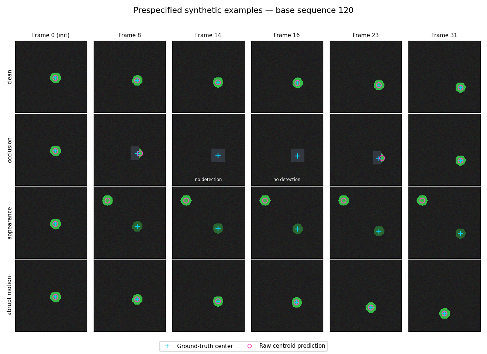

# 2026-10-16 — A stable wrong track can look reliable

The first diagnostic is complete. Adding a constant-velocity residual did **not** solve the deliberately constructed identity-switch failure. Once the color segmenter settled on a stationary distractor, its recent positions became consistent again. This is a counterexample in a toy renderer, not a new finding about learned trackers or robots.

## Material Passport

- Origin Skill: academic-research-suite / experiment-agent
- Origin Mode: run and analysis
- Origin Date: 2026-10-16
- Verification Status: VERIFIED by a separate same-environment rerun and independent metric recomputation; external-data validation remains unperformed
- Version Label: diagnostic_0001_v1
- Contribution: Codex-assisted planning, implementation, review, and execution under the owner's authorization

## What ran

The [protocol](../protocols/0001-synthetic-localization.md) was committed as [`a5ab4e3`](https://github.com/Simonn777/embodied-vision-reliability/commit/a5ab4e31699d6e55a81153aedd891c577bcb29d8), before the complete test run. Implementation and tests were committed and pushed as [`bc9921f`](https://github.com/Simonn777/embodied-vision-reliability/commit/bc9921fc14ad2f3df4e7f2f2dd81035c4c91a746). Source files were unchanged at execution. No parameters or thresholds were retuned after these results.

The run generated 160 base sequences in four conditions, with 32 RGB frames per sequence-condition pair. Frame 0 initializes the tracker and is excluded from metrics. Of the resulting 19,840 scored rows, **4,960 belong to the 40 test sequences**. The other partitions are reserved fit/development data and clean-only threshold calibration; no learned model was trained. There are 40 independent test units, not 4,960 independent samples.

All three threshold policies retained 496 of 620 clean calibration frames (80%). Thresholds were then applied unchanged. CPU execution on an Apple M5 took **9.22 seconds**, including exports and plots. This is one local diagnostic run, not a hardware benchmark. The [provenance](../results/0001-pilot/provenance.json) contains exact versions, timing, commands, and hashes.

## Observed operating points

Coverage is accepted predictions divided by **all** scored frames. Selected failure is the fraction of **accepted** predictions whose position error exceeds 2.5% of the image diagonal. Both policies use exactly the same raw centroid estimates.

| Test condition | Static coverage | Static selected failure | Temporal coverage | Temporal selected failure |
|---|---:|---:|---:|---:|
| Clean | 87.10% | 0.00% | 88.63% | 0.00% |
| Occlusion | 42.10% | 0.00% | 37.02% | 0.00% |
| Appearance change + distractor | 79.44% | 75.53% | 91.45% | 77.60% |
| Abrupt motion | 86.61% | 0.00% | 85.48% | 0.00% |

The full [summary](../results/0001-pilot/summary.json) also includes random ranking and accepting every available prediction, missing outputs, normalized error, curves, and sequence-bootstrap intervals. Under occlusion, the common estimator misses 12.90% of frames. Accepting every available prediction gives 87.10% coverage and 38.15% selected failure; missing predictions remain in the denominator for coverage and all-frame failure.

## What these numbers do and do not say

In the occlusion condition, the temporal score returns fewer answers with the same observed zero selected failures: its coverage is 5.08 percentage points lower, with paired sequence-bootstrap 95% interval **[−7.18, −2.33]** points. That is a coverage cost in this diagnostic, not evidence of a better selector.

In the appearance condition, the temporal score accepts 12.02 percentage points more predictions, interval **[2.66, 22.43]**. Its selected-failure difference is +2.07 points, interval **[−0.77, 5.68]**. These are different operating coverages, so the conditional-risk difference is not a matched-coverage superiority test. Both policies plainly fail to reject many wrong identities in this constructed setting.

The apparent mechanism is visible in the fixed example below: the correct target fades, the bright distractor captures the segmenter, and a stable but wrong centroid can have low motion residual after the initial jump. The score tests consistency of recent positions, not persistence of target identity. This is a design-based interpretation; it needs a discriminating ablation and external-video test before generalization.

Intervals resample entire test sequences in 1,000 paired draws while holding the calibration sample fixed. All reported conditional intervals had 1,000 defined draws. Zero failures and a bootstrap interval of [0,0] in some conditions reflect the observed sample; they do not establish zero population risk or a safety guarantee. No interval here covers uncertainty about other renderers, calibration samples, or real video. The clean test acceptance rate also differs from the 80% calibration target; that target is not a deployment guarantee.

## Verification and artifacts

- 17 tests cover causal inputs, pixel-dependent estimates, split isolation, calibration restrictions, missing outputs, tie rules, known metric values, paired sequence resampling, and additive per-sequence exports.
- [GitHub Actions](https://github.com/Simonn777/embodied-vision-reliability/actions/runs/38854274446) passed the tests and a separate smoke partition on Linux/Python 3.11. The complete run used macOS/Python 3.9.6.
- A separate Codex worker reran the full experiment in the same environment: all six deterministic configuration, data, and figure files matched byte for byte. The rerun took 10.13 seconds. An independent calculation from exported rows/totals also matched the metrics and all 112 bootstrap interval endpoints. [Verification record](../results/0001-pilot/reproduction.json). This is not an independent dataset or external-lab replication.
- Original artifacts: [predictions.csv](../results/0001-pilot/predictions.csv), [sequence_totals.csv](../results/0001-pilot/sequence_totals.csv), [config.json](../results/0001-pilot/config.json), [summary.json](../results/0001-pilot/summary.json), [provenance.json](../results/0001-pilot/provenance.json), and the two figures above. All saved artifact hashes were checked.

## Decisions and next work

Keep the negative result and the frozen data. Do not tune away this failure and rebrand the same test trajectories as untouched evidence. Next, inspect tracker confidence/identity assumptions in TAPIR and selective-regression methods, then write a new protocol for the smallest suitable external dataset. The [data audit](../docs/DATA_SOURCES.md) identifies a 187 MB synthetic robotics archive as a feasible intermediate step and a separately licensed real-video candidate; neither has been downloaded.

The [reading list](../docs/LITERATURE.md) now contains 11 primary-source entries, including ICML, CVPR, and ICLR 2026 work, with actual reading depth labeled. A public year-long charter and daily continuation task have been established. Scheduling is not a completed experiment, and paper screening is not a reproduction of those papers.

## Hosted-execution preparation

At the owner's request, a GitHub-hosted daily pipeline was added for future work
while the development Mac is offline. It separates model execution, isolated
testing, and publication. 83 tests passed locally; the
[cloud preflight](https://github.com/Simonn777/embodied-vision-reliability/actions/runs/38855628928)
passed. No AI API call or research publication occurred in that preflight.
Production remains disabled pending credentials, an approved API budget, and a
real end-to-end run. The desktop schedule remains unchanged during migration.
See [the execution contract](../docs/CLOUD_EXECUTION.md). This is infrastructure
verification, not a new scientific finding.

## Subscription-based execution trial and resource correction

The owner subsequently specified no additional fees. The API workflow is now
disabled at both the workflow and activation-variable levels. A subscription-based
cloud Scheduled task was created and trialed, then paused after an actual GitHub
integration write returned 403 and the cloud shell could not resolve GitHub for
cloning. No new experiment, branch, or PR was produced by that trial. Installing
the connector for this repository and validating a real publication remain open;
the existing local schedule remains active. See the
[current execution record](../docs/CLOUD_EXECUTION.md#subscription-based-cloud-trial).

The trial also found that the runner replaced inherited thread settings with four.
The correction respects lower inherited limits, rejects invalid values before
changing the environment, and records the effective values. 83 local tests passed;
a separate smoke run with a two-thread cap completed 1,240 rows in 1.14 seconds.
Its scratch provenance correctly records uncommitted source at execution. This
was a resource-control check, not another final-test comparison; the original
protocol and result artifacts were preserved.

## Interactive Work cloud capability retry

The authorized repository-only connector created [PR #1](https://github.com/Simonn777/embodied-vision-reliability/pull/1). In this session the Work cloud shell successfully cloned source `e05a5877d1985edfdce48a8991420900fd95adc7`, installed declared dependencies, passed 83 tests (1.35s), and completed a distinct two-thread smoke (1,240 rows, 3.34s) under a 6 GiB address-space limit and 900-second command timeout. The new [PR CI](https://github.com/Simonn777/embodied-vision-reliability/actions/runs/38859005472) independently passed 83 tests and smoke on a GitHub-hosted runner; decoded job logs were inspected. [Receipt and provenance](../docs/CLOUD_CAPABILITY.md) distinguish those execution sites. The updated receipt must pass CI again before exact-head merge. This is infrastructure validation only; no full final-test repeat, new scientific claim, scheduling change, paid service, or credential transfer occurred. Scheduled execution remains unverified and paused.

## Failure mechanism follow-up: two frames of warning

Completed the second research-queue item by analyzing the saved 0001 predictions,
not by rerunning the estimator or changing its thresholds. The [failure report](../docs/analysis/0001-failure-mechanism.md)
separates measured counts, the scorer's algebra, and limitations of the color
estimator and synthetic renderer. This is exploratory analysis of an already
visible test set; its phase choices are not new confirmatory endpoints.

- In appearance frames 8–9, temporal rejects all 80 wrong predictions. In frames
  10–31, its residual is exactly zero and it accepts all 880 wrong predictions;
  static accepts 682. Two raw wrong positions replace the motion history, and
  the separately calibrated temporal threshold is wider. Consistency is not
  evidence of correct identity in this construction.
- At the abrupt turn, all 40 estimates are within tolerance; temporal rejects all
  40 while static accepts 35. After occlusion clears, frames 24–25 contain 80
  correct estimates with identical coordinates/static scores/errors to paired
  clean frames; temporal rejects all 80 while static accepts 72. History explains
  the extra rejection within this diagnostic.
- Both gates reject all partial-mask frames, including 68 predictions still
  within tolerance. The area term alone exceeds the static threshold. This
  result does not establish a benefit from temporal information.

[Artifacts](../results/0001-failure-analysis/) contain all phase counts, per-frame
and per-sequence exports, the full prespecified sequence-120 trace, and 1,000
paired sequence-bootstrap draws summarized as intervals (seed 20261018).
Missing predictions remain in coverage denominators; all-rejected conditional
risk remains undefined. Phase intervals are unadjusted, exploratory, and
conditional on the same renderer and frozen calibration. Original overall
intervals are quoted separately in the report.

The standard-library analyzer verifies original hashes and saved acceptance
flags before analysis. It ran in **0.514 seconds** on Python 3.9.6/macOS; a second
run took **0.520 seconds** and matched all six deterministic files byte for byte.
A separate AI worker independently counted the raw CSV and reviewed the
mechanism/aggregation. The complete test suite passed **107 tests in 5.47
seconds** under a two-thread numerical-library cap. [Execution provenance](../results/0001-failure-analysis/provenance.json)
and [verification](../results/0001-failure-analysis/verification.json) record
commands, hashes and the fact that analysis code was uncommitted at execution.
Original protocol/source/measurements are preserved. No weights or datasets were
downloaded and no model inference or paid service was used.

[Primary methods reading](../docs/literature/2026-10-16-confidence-methods.md)
now records named sections of TAPIR v2 and CoTracker3 v1 plus pinned official
code. Native position-error confidence differs from visibility and may already
use temporal context. A Boolean online wrapper discards ranking information;
first-query evaluation does not by itself establish causality. These findings
change the baseline audit, not the original experiment or its claims.

**Next:** audit one external dataset and one exact causal estimator/checkpoint,
including raw confidence outputs, input-frame access, licenses and local resource
cost, before freezing protocol 0002. Do not tune on 0001's test trajectories.
The cloud-schedule migration remains unchanged: interactive Work publication is
verified, unattended Scheduled execution is not; the local schedule remains.

## Non-interactive cloud research: dataset and frozen-model audit

Advanced NEXT_ACTIONS item 3 through a [pinned source and header audit](../docs/data-model-audit-2026-10-16.md) and [machine-readable evidence](../docs/data-model-audit-2026-10-16.json). Seven official source files were fetched as text and hashed at TAPNet `730cda1c730877cfedbe01bf87fb1cadb78a565d`; direct source retrieval worked after the web renderer failed for the pinned pages. Fresh HEAD requests returned HTTP 200 for RGB-Stacking (187,291,581 bytes) and Online BootsTAPIR (218,887,028 bytes), with object generations recorded. No binary dataset/weight body was downloaded and no pickle/checkpoint was loaded.

Conditional decision: use this licensed, small synthetic pair for the next feasibility stage, not as real-video validation. The causal notebook supports one-frame input with saved context, but query descriptors must be initialized only at arrival, raw confidence/visibility logits must be retained, and refined confidence is a temporal baseline. Exact prefix invariance, scene grouping, checkpoint integrity, dependency/storage cost, CPU runtime and peak memory remain unmeasured. The next step is protocol 0002's acquisition/development stage; the final split and evaluation must be frozen before later final inference.

This non-interactive Work cloud invocation exposed shell plus branch/tree/commit/PR/CI/log/merge connector tools. Source main was `14b3e5fd83190a1be9e8941d2fd2770acca485ca`; no open PR was present at the start. The initial test attempt failed because pytest was absent; `python -m pip install -e '.[dev]'` installed the declared small dependencies. Linux x86_64 / Python 3.12.14 then passed **107 tests in 2.57s**. A distinct smoke (`python scripts/run_experiment.py --smoke --output scratch/scheduled-audit-smoke --protocol protocols/0001-synthetic-localization.md`) completed **1,240 rows in 3.92s**. Both commands used a 6 GiB address-space cap, 900-second timeout and all five numerical-library thread settings at 2. Source/configuration hashes and measured environment are preserved in [smoke provenance](../docs/cloud-capability/2026-10-16-research-smoke-provenance.json). Its protocol-commit field reflects shallow local history; the immutable protocol SHA-256 is recorded and the original protocol freeze remains `a5ab4e31699d6e55a81153aedd891c577bcb29d8`.

Only source-audit documentation, metadata, state and this append-only note change. The full final-test experiment, old results, protocols, workflows and schedules remain unchanged. Publication requires this PR's exact head to pass new Research checks CI, with jobs/logs reviewed and an expected-head merge. This is research preparation and execution evidence, not a measured model benefit or a guarantee about future runs. No additional fees, expanded connector scope, paid API, credential transfer or human messages were involved.

## Schedule migration verified

After the cloud research run, the settings session independently inspected its non-interactive Work turn, actual command outputs, PR #2, CI job/logs and remote main `9d415308d2eae55d94f972ced969563e3a862ea4`. The automation's native Run now trial completed at 12:22:26 EDT; it was not a manual research-message substitute. Cloud shell: 107 tests / 1,240-frame smoke; GitHub CI separately passed 107 tests / 1,240 frames. The [migration receipt](../docs/SCHEDULED_VERIFICATION.md) links the exact publication and timing evidence.

The saved Work-context task is enabled, daily 09:00 America/New_York, ending October 15, 2027, with “Same chat for every run.” Its next regular run is October 17, 2026. Only after verification was the old local heartbeat paused through the app's automation tool; both superseded cloud candidates remain paused. The paid API workflow remains disabled and its activation variable remains false. No added-fee service, credential transfer or connector-scope expansion was introduced. The first clock-triggered run and long-term availability are still future events, not claimed results. Research resumes with protocol 0002 development feasibility.

## Real-weight Online BootsTAPIR cloud CPU development feasibility

The explicit follow-up authorization requested a review-only PR with real CPU forward measurements and no schedule changes. Started from `9cb586e039fb11faa5d00e3f20cc8e692397ce5c`, with no open PR or active experiment. A fresh worktree preserved the prior session's local edits. [Protocol 0002-D](../protocols/0002-development-feasibility.md), configuration, adapter and tests were published as `e9ca032d9fdc48b6b3d0ed9d0ac7c04c314a76ac` before acquisition/inference; `e11b70a8` strengthened source hashing before the preliminary run. Independent review prompted [revision 1](../protocols/0002-development-revision-1.md), published with repaired source as `d45c1bed4f82dd4237373567df1920a9a9ca7189` before the serial validated rerun. No original protocol or final experiment was changed.

[Measured report](../docs/0002-cpu-feasibility.md) and [raw receipts/scalars](../results/0002-development/): real official 54,699,335-parameter weights, torch 2.10.0+cpu, frozen causal model, CPU affinity/two intra/inter-op threads and all five numeric-library settings at 2, 6 GiB address-space cap, external timeout 900s. Whole archive video index 0 is permanently development; only frames 0–15 were inferred. One query/16 frames took 8.276s; first cold frame 0.636s; subsequent single-run median 0.518s; two-query/16-frame batch 9.190s. Main validation wall time 63.504s, peak RSS 746,092 KiB; decoder peak 2,572,184 KiB. This does not establish realtime or full-dataset feasibility.

Future-image and truncated-prefix differences were zero, late-query arrival versus an independent cropped stream was zero, same-process and fresh-process replay were zero; real single/batch maximum difference was 2.7656555e-5, within the original atol 1e-4, rtol 0. Output shapes, finite active values and pre-query masks passed. Stateful fake-model tests check continued history, new-group initialization and zero-active bypass. CSV-only independent recomputation matches all recorded comparisons.

Retained setup/failure history: old torch 2.5.1 dry-run/install downloaded packages before review; no checkpoint was loaded under it. Official GHSA-63cw-57p8-fm3p was checked, then CPU 2.10.0 was pinned for actual loading. A credential-cleared acquisition failed DNS; normal platform networking fetched the public bodies, while decoding/inference stayed in credential-cleared processes with allowlisted NumPy reconstruction and weights_only=True. Source-origin, decoded-array/manifest and nonzero validation-failure gates were repaired after independent review; the earlier real-weight outputs remain explicitly preliminary. A packaging import-path error was corrected without repeating inference. The transfer ledger counts old/fixed dry-runs and installs, small dependencies, model/data and overhead: conservative ceiling 1,454,567,918 bytes, not inferred from cache size.

Final local suite: 129 passed in 3.07s; existing toy smoke: 1,240 rows in 2.84s. These are regression checks, not model-performance data. The [future exploratory protocol draft](../protocols/0002-exploratory-pilot-draft.md) defines visible opportunities, missing/zero-accept risks, paired matched-coverage comparisons, a prospective 2-point practical effect and video-cluster bootstrap. Full scene relationships, exact allocation and longer development profiling remain unresolved; no final freeze or evaluation is claimed. PR #4 remains open for independent review after exact-head CI; this session does not merge, change any schedule, send messages, or incur additional fees.

### Parent-session artifact verification

The delegated cloud run ended with PR #4 open as requested by the parent session. The owner's authorization covers publication after independent review; the review-only restriction above applied to that delegated execution. The parent fetched head `c2d3d1c5031713ec8ee82590887635df44bee0c9` and verified all 20 artifact digests, executed-source/config hashes, acquisition/manifest bindings, raw row identities and active values. Recomputing the published CSV comparisons reproduced every recorded result, including the fresh-process replay. A separate calculation without importing the candidate implementation agreed. All 104 validated per-frame latency rows reconcile with the eight run receipts. This is independent verification of saved measurements, not another model inference or a second dataset.

[Exact-head CI 38959203658](https://github.com/Simonn777/embodied-vision-reliability/actions/runs/38959203658) passed 129 tests in 3.19s and the existing 1,240-row toy smoke in 3.80s. [The parent verification receipt](../results/0002-development/parent-review.json) records the reviewed head and evidence boundary. The README now links the real-model report, and next actions retain the unresolved grouping, longer-clip and final-freeze gates. No original measurement file was changed during this review.

Code/artifact and research-design reviews found no blocker to publishing this feasibility result. The unfrozen proposal's undefined adjective "clean" was removed from the calibration description; no clean/shift generation procedure or evaluation result is implied. A future runner revision should also refuse reused output directories and persist per-frame latency after each completed subrun; the separately preserved completed runs here are unaffected.

## 64-frame development and exploratory freeze (AI-assisted)

Published pre-run plan/source db513434, audited50video/150array/12500frame identities, then ran onlyvideo0 first64frames with firsttwo frame0-visible points0/1. Preserved original42.868/43.121s runs. Published recording addendum0773f28 before a serial same-data replay:39.337s two-query64,10.350s single16,39.450s independent-process64; peak794764KiB, replaymaxdiff0, single/batchmaxdiff2.7656555e-5, atol1e-4/rtol0. Rawoutputs/times/UTC/environment/source/input hashes remain in results/0002-preflight-recording.

No exact intervideo frame/prefix/full duplicates:50singleton groups with1development/10calibration/20evaluation/19reserve, independently recomputed. Other49 onlymetadata identity access, no inference/error inspection. Shared triplet-4 objects/front-left camera known, scene dependencies/near duplicates/upstream causal checkpoint exposure unknown. Implemented independent0002 stable scores, missingness, strict4px/80% ranking/calibration, controls and paired complete-group2000bootstrap, including empty/repeated groups. Synthetic fixture traverses the full future prediction-to-metrics path. Finalscope is exploratory video-held-out, not scene-independent confirmation; six-pixel uncertainty-head training target remains a limitation.

Inputs are committed before a separate noncircular freeze receipt. No calibration/evaluation run here; parent independently reviews and merges PR5 before nextsession g-033. No new binary downloads, paid services or schedule changes; inheritedtransferceiling plus8MiB metadata allowance1462956526bytes<10GiB. See docs/0002-64frame-and-freeze.md.

## PR #5 pre-merge repair: supersede freeze v1 before evaluation

Independent parent review identified P1: verify_freeze accepted caller-selected
hash/dependency maps and current files without matching input-commit blobs; an
untracked receipt could be substituted. Repaired the gate to require the exact
canonical tracked/committed/main-published v2 receipt, fixed complete mandatory
input/dependency collections, all input commit/HEAD/current hashes, canonical
config/protocol/manifest paths and dependency/upstream/model/archive identities.
Added local Git fixtures for valid publication and old-commit/new-hash, empty/
missing/extra maps, dirty/staged/untracked/unpublished receipt, dependency and path
substitution failures. There is no bypass flag. V1 artifacts are retained
byte-for-byte but explicitly superseded BEFORE any calibration/evaluation.

Only software tests and the existing toy smoke run for this revision. No model,
metadata decoding, package/data download, paid resource or schedule change.
V2 inputs are published before a distinct receipt commit referring to their SHA;
receipt excluded from the input tree/map. No held-out outcome access occurred.
Parent independently reviews/merges PR #5; future execution uses only v2 after a
fresh authorized origin/main update. AI-assisted repair and documentation.

Repair validation: 184 tests passed in 7.08s; existing 1,240-frame toy smoke
completed in 3.10s. No model or metadata rerun. The v2 software receipt is
results/0002-preflight/freeze-v2-validation.json; final-head CI is checked separately.

## Final independent review of the 64-frame stage and v2 freeze

AI-assisted review of the published cloud artifacts recomputed six raw CSVs,
12,500 frame-hash entries, the 1/10/20/19 allocation and historical source hashes.
The recorded 39.337325-second forward pass and 39.450014-second independent-process
replay agree exactly in their predictions. No new model inference was performed.

V2 input `bbe7428e` and separate receipt `fbb6dd92` passed all 29 input, six
prerequisite and 16 recorded-dependency bindings. A separate temporary-Git harness
accepted two valid chains and rejected 71 invalid cases; package-version queries
were mocked solely to isolate the provenance gate. Main publication is a required
execution condition, and the unmerged candidate correctly fails that condition.
[Full review](../docs/0002-independent-review.md) records the evidence boundaries.

Exact candidate CI [38966088707](https://github.com/Simonn777/embodied-vision-reliability/actions/runs/38966088707)
passed 184 tests and the existing 1,240-frame toy smoke. The final publication
retains the original v1 and v2 input/receipt commits. The next research step is
calibration group g-033, only after fetching and verifying the main-published v2
freeze. Calibration/evaluation model inference and efficacy analysis remain
unperformed; no additional paid service was activated.
