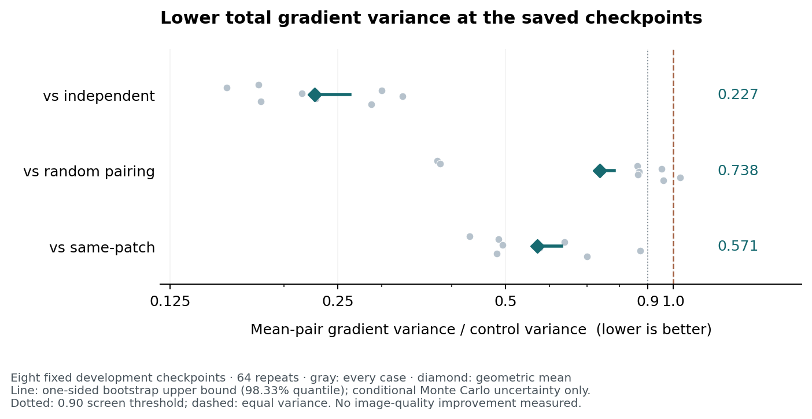

# 0007: fixed-checkpoint gradient screen

**Decision: `pass_local_mechanism_screen_only`.** All prespecified gates passed.
This AI-assisted development measurement supports a separately designed
optimization study; it establishes neither denoising quality nor faster training,
real-camera efficacy, novelty or a paper result. No optimization study ran here.

The execution checkout was main `ca7fad653af31f93d770ede11a7f7ffdb5d12ec0`.
Scientific source `67bccdd57a2ec4a8204cf42a159c374caed0be2b` and canonical
freeze `dd7c84c9afb774e2d411cf815aa17f953409d6e6` preceded measurement.
[Bindings](freeze-bindings.json) identify all eight required files and 24 exact
cached input/weight/identity files. The result publication commit is separate
from the execution main; it does not identify the code used retrospectively.

## Actual run and checks

- Eight colored R2R checkpoints, both regimes, four methods and 64 replicates:
  **4,096 completed batch forward/backward pairs**, 512 occurrences per batch,
  5,313 parameters, **zero optimizer updates**. Parameters remained identical.
- No clean reference, old prediction or score was read for scientific computation.
  No asset acquisition, installation or paid service. The historical conservative
  asset ceiling remains **7,532,690,072 bytes**, with **0 new asset bytes** here.
- Frozen runtime tests: **43 passed, zero skips**, unittest time 3.928 seconds;
  actual outer exit 0, wall 4.851 seconds. Independent checker's pre-dispatched pinned
  SHA is `2e6ab7912ee1e56836da9cd61b059598d09125eb87d9693c1be8a79bd17fde6e`;
  its separate 11-group self-test passed before the measurement.
- Scientific outer wait4: **exit 0 / raw status 0**, wall **24.228883 seconds**,
  peak child RSS **331,152 KiB**, user/system CPU **40.903402 / 2.520892 seconds**.
  Frozen study wall was 24.170182 seconds. UTC interval:
  **2026-10-18 20:07:39.813344–20:08:04.042219**.
- CPU-only Torch **2.10.0+cpu**, NumPy **2.0.2**, Python **3.12.14**,
  Linux 6.18.55 x86_64; AMD EPYC 9V74 host. Four affinity slots [0,1,2,3],
  numeric threads 4, Torch interop 1, deterministic algorithms and 8 GiB address
  space. Study hard cap 900 seconds; each case external 120 / core 90 seconds.
- [Saved-evidence check](outer-control/integrity.json) passed before score:
  every closed stdout/stderr, command digest, wait record, receipt, array/content
  hash, completion mask and all 4,096 individual gradient/loss/timing records
  agree. All 24 inputs, **2,342 prior tracked files (2,130 results)**,
  **407 failed-cache files** and **22 prior marker files** were preserved at
  that check. Publication review separately allows only the three state/note edits.
- Frozen score ran **once**, exit 0, wall **3.185496 seconds**, peak RSS
  **409,520 KiB**. [Exact scores](study/scores.json) SHA256:
  `ff4542f059ae02cce36aeacfda2d5346075e524d7863e8666b5346756c8306a9`.
- [Independent saved-gradient replay](outer-control/independent-replay.stdout.log)
  used coordinate-wise variance and the pair-distance bootstrap identity,
  without production/Torch imports or model calls. Exit 0, outer wall
  **2.234265 seconds**, peak RSS **134,516 KiB**; **5,351 checks**, including
  3,205 scalar comparisons, 2,000 bootstrap draws and 576 projection checks.
  Maximum absolute discrepancy **1.3322676295501878e-15**; tolerances were fixed
  at rtol 1e-10 / atol 1e-12. It agrees with the decision and all gates.

## Frozen results

The figure is generated from the frozen public score summaries; all eight cases
appear, including the case that loses to random pairing. It introduces no new
measurement or decision rule.

Ratios below are geometric means over the eight fixed checkpoints. The bootstrap
upper uses the prespecified one-sided quantile 0.9833333333333333, conditional on
these checkpoints and substrates; it is not independent-scene uncertainty.

| Regime | Mean pairing / control | Variance ratio | Bootstrap upper | Variance × step-time ratio |
|---|---|---:|---:|---:|
| A fixed batch | independent | 0.050379 | 0.057947 | 0.056479 |
| A fixed batch | random pairing | 0.428330 | 0.467950 | 0.479907 |
| A fixed batch | same patch | 1.915416 | 1.990896 | 2.144005 |
| B redrawn batch | independent | 0.227245 | 0.262994 | 0.247565 |
| B redrawn batch | random pairing | 0.737618 | 0.783453 | 0.864655 |
| B redrawn batch | same patch | 0.570518 | 0.630103 | 0.628317 |

| Prespecified gate | Actual | Pass |
|---|---|---|
| Finite positive variances/times/denominators | all required quantities valid | yes |
| Projected mean integrity | 576 / 576 checks, zero warnings | yes |
| A mean/random variance < 1 | 0.42833040059918165 | yes |
| B variance ≤ 0.90 against each control | 0.227245 / 0.737618 / 0.570518 | yes |
| B bootstrap upper < 1 against each control | 0.262994 / 0.783453 / 0.630103 | yes |
| B beats smallest control in ≥ 6 cases | 7 / 8 | yes |
| Total B mean/independent step time ≤ 1.10 | 1.0881917194078208 | yes |
| B variance × time ≤ 0.90 against each control | 0.247565 / 0.864655 / 0.628317 | yes |

The mean rule lost to random pairing in B for d4-colored-0 (ratio 1.028036),
and A's same-patch variance was lower in all eight cases. Same-patch uses a
different empirical objective in A and is deliberately excluded from A's
mean-equality checks. No contrary outcome was hidden. Full per-case values,
all 64 variance estimates, timings and projected diagnostics are in scores.json;
[case index](case-index.json) gives raw-file and receipt identities.

## Reproduction and provenance boundaries

The private output is `<PROJECT_ROOT>/antithetic-gradient-0007`; full gradients,
noisy arrays and weights stay there or in the original cache. No reconstructable
arrays, images, references or weights are published. Eight full case receipts,
started/completed records, closed logs, source bindings and outer wait4 records
are archived. [Copy manifest](copy-manifest.json) distinguishes exact copies from
explicit path redactions. Private argv files are **not** public originals: their
recorded digests bind actual commands, and `.command.recipe.json` files replace
paths by `<PROJECT_ROOT>` and `<PYTHON>`. Resolve those placeholders only to the
original fixed environment. Never rerun the one-shot scientific operation merely
to reproduce the publication; use the saved-gradient checker instead.

An initial outer preflight command used the wrong relative script path and exited
2 before preflight execution. Its original failure and corrected-command success
are retained. The final archive text scanner also rejected its own source's
literal credential-detection string; the completed text copies and manifest were
preserved and independently inspected, without rerunning science or score.
These are orchestration failures, not model failures. Outer parent receipts
observe their timeout child via wait4; the parent itself has no additional outer
exit observer. The parent directly inspected the first four source/preflight tool
calls. Retrieval of the later command-tool records failed because the single
cloud turn exceeds the read tool's size limit, even with outputs disabled.
Scientific, score and replay exits are therefore supported here by the archived
wait4/log chain, not independent observation of every outer tool return.
Private gradients, failed-cache files and markers were not retrieved or rehashed
locally; their replay/preservation is documented by the bound cloud artifacts.

The old 0006 stdout defect remains **OPEN**, its failed candidate remains stopped,
and 0003 remains deferred. This new local pass does not repair either history.
The four substrates are development data forever, generic antithetic coupling
is established prior work, and no effectiveness or novelty claim follows.
[Independent parent review](parent-review/README.md) now verifies public arithmetic,
all original archive bindings and preservation of 2,164 older result/protocol files.
Next: a separate prospective optimization design with matched resources and a
meaningful task-quality gate **before** training.
