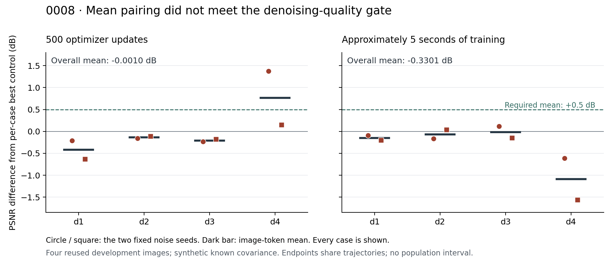

# Independent parent review: numerical agreement, candidate stopped

**Both independent reviews passed; the frozen scientific decision remains `stop_this_candidate`.** The result at `70bc57fd83634a8df66aecf072ea9b526e3af043` contains 32 shared training trajectories and 64 endpoint predictions. Mean-based antithetic pairing failed both quality requirements. Passing provenance and arithmetic checks does not turn a negative result into an effective or novel method.



Every case and both noise seeds are shown. The comparator is the per-case PSNR-best control, an oracle rather than a deployable selector. The endpoints share training trajectories. Four reused image substrates with synthetic known covariance do not support population intervals, independent-scene generalization or real-camera efficacy. The figure renders the unchanged saved scores; it is not a new inference or scoring run.

## Two independent review layers

| Review | What was independently checked | What was not repeated |
|---|---|---|
| [Public numerical review](metrics/README.md) | **89,135 checks / 1,609 numeric comparisons**, maximum difference **1.0658141036401503e-14**. Reconstructs MSE/PSNR from all 4,096 public block SSE/count summaries, oracle comparisons, quality gates, timing allocation and receipt links. | No pixels, private references, predictions, weights, production metric imports or model calls. The cloud saved-array replay is separate evidence. |
| [Publication provenance review](provenance/README.md) | **9,885 checks** covering all 265 original cloud files, original/redacted hashes, 2,285 old result/protocol Git blobs, 13 frozen inputs and the canonical receipt. All nine stage records equal records independently extracted from the original tool returns. | No private cache files were fetched or rehashed. Their preservation remains the scope of the observed cloud postcheck. Tool records are not syscall-level attestation. |

The public arithmetic reproduces mean gains of **−0.000955546 dB** at 500 updates and **−0.330065288 dB** at five seconds. Positive image means are 1/4 and 0/4. Both mean-quality, positive-image and image-harm gates fail. Texture and allocated-cost gates pass, with cost ratio **0.995749479**; neither rescues the quality failure. Allocated endpoint times are correlated portions of one observed trajectory, not separately timed reruns or additive consumed compute.

[Redacted parent observations](tool-observations.json) retain 18 command records and nine complete stage outputs, including truncation declarations for unrelated source-read outputs. They exclude original private paths, conversation metadata, reasoning and personal prompts. The original retrieval remains private. The original cloud publication reviewer’s historical-link failure remains in the [unchanged archive](../publication-control/verify.execution.json); its correction did not rerun science or alter old note text. The 0006 stdout defect remains open.

## Reproduction and packaging

The original 265-file cloud archive, including its two manifests, is unchanged. This directory is a separate layer with [its own hashes](artifact-hashes.json) and [packaging bindings](packaging-bindings.json).

The three metrics files were copied byte-for-byte. From the repository root:

```sh
python3 results/0008-antithetic-training/parent-review/metrics/review_public_metrics.py \
  --repo . --report NEW_PUBLIC_SUMMARY_REVIEW.json
```

This only recalculates published summary algebra and checks Git objects. It does not call the frozen scorer. A copied-script replay and packaging/link checks are recorded in [publication validation](publication-validation.json).

The public provenance script is a parameterized packaging revision of original SHA256 `7ba74b8aebc9ca862363f47e57cd52274b202c31dc0e79201ea32a3cf3a9c214`. The original report and execution receipt remain exact. Reproduction requires the private execution retrieval and a **separate clean checkout at the original result commit**; see [its instructions](provenance/README.md). The packaging revision itself received syntax/help checks only, not another full provenance run. No private input file is published.

The [plot script](plot_quality.py) accepts explicit input/output paths and checks the original score hash. Its PNG was copied from the reviewed rendering without modification. It requires Matplotlib only for rendering, not to inspect the saved figure or run the standard-library reviews.

AI-assisted independent review and original visualization; repository MIT terms apply to this original code and figure. Underlying data rights are unchanged. No scientific rerun, new asset acquisition, paid service, manuscript or institutional endorsement follows. PR, merge and exact-commit CI verification remain pending at this working-tree integration stage.
